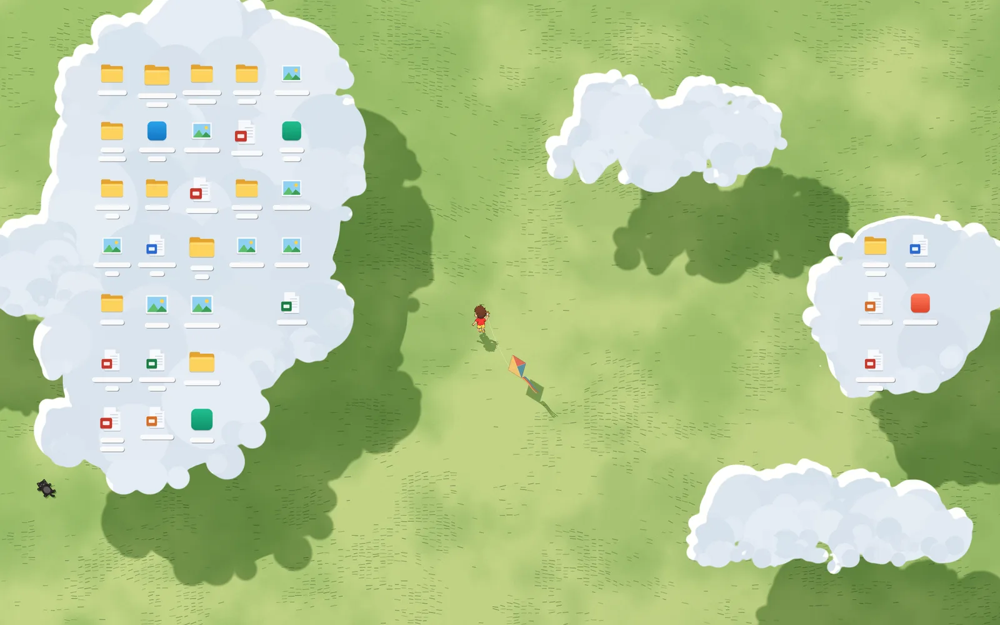
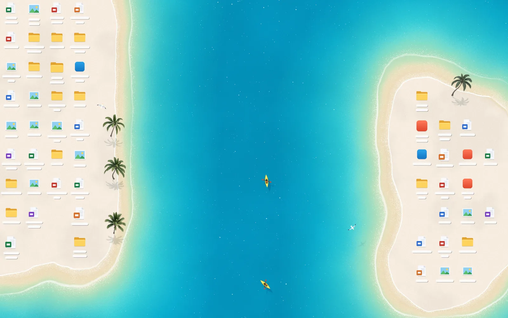
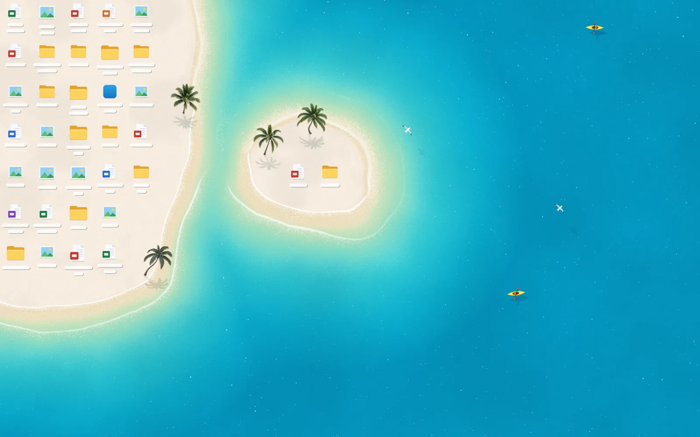

# Deskland Preview (Bản mở rộng Tiếng Việt / Vietnamese Extended Edition)

**Hình nền động thích ứng cho Windows — biến các biểu tượng trên màn hình nền thành một phần của phong cảnh.**

Deskland biến không gian quanh các biểu tượng màn hình nền thành một khung cảnh sống động. Khi bạn di chuyển, thêm hoặc xóa biểu tượng, bờ biển, đồng cỏ, đám mây, tán cây và mặt nước sẽ tự động uốn lượn bao quanh theo thời gian thực ngay trên máy — không dùng AI, không cần tài khoản hay API key.

> **Nguồn gốc & Giấy phép (Attribution & License):**
> Dự án này là bản phái sinh (fork/modified version) dựa trên dự án mã nguồn mở gốc **[Deskland](https://github.com/BLEZZ0102/Deskland)** (`Copyright (C) 2026 Deskland authors`, trang chủ: [deskland.app](https://deskland.app)), được phát hành và tiếp tục phân phối theo giấy phép **[GNU General Public License v3.0 (GPL-3.0)](LICENSE)**.

**Tiếng Việt** · [English](#english-overview) · [ Dự án gốc (Upstream)](https://github.com/BLEZZ0102/Deskland) · [Cách biên dịch](#biên-dịch-từ-mã-nguồn) · [Giấy phép](#bản-quyền-và-giấy-phép)







---

## Các điểm cải tiến trong bản mở rộng này (Modified on 2026-11-10)

Theo Mục 5a của giấy phép GNU GPL v3.0, bản sửa đổi này bao gồm các thay đổi sau so với bản gốc:

1. **9 chủ đề WebGL2 hoàn chỉnh (loại bỏ toàn bộ các thẻ chủ đề khóa/phải mua):**
   - **Đồng cỏ (`meadow.html`):** Mây trôi và bóng mây trên đồng cỏ, cậu bé thả diều và chú mèo đen nhỏ (tác giả gốc).
   - **Bãi biển (`flat.html`):** Sóng biển màu ngọc lam, thuyền kayak, chim biển và hàng dừa (tác giả gốc).
   - **Maldives (`maldives.html`):** Biển ngọc bích trong vắt, rạn san hô, đàn cá nhiệt đới, rùa biển, thuyền kayak và cây dừa.
   - **Bờ hồ (`lake.html`):** Nước hồ xanh ngọc tĩnh lặng, lá súng, hoa súng nở và cá Koi bơi lội.
   - **Bầu trời (`sky.html`):** Biển mây bồng bềnh quanh các biểu tượng và đàn chim lượn trên bầu trời.
   - **Biển cả (`ocean.html`):** Đảo mây giữa đại dương xanh thẫm, thuyền buồm trắng và cá voi phun nước.
   - **Rừng mưa nhiệt đới (`rainforest.html`):** Tán rừng nhiệt đới rậm rạp, sông Amazon uốn lượn, mưa rơi, đom đóm và chim Toucan.
   - **Mùa hoa mận Mộc Châu (`mocchau.html`):** Đồi chè xanh, rừng hoa mận trắng nở rộ, sương mù bảng lảng và cánh hoa bay trong gió.
   - **Hoa đào ngày Tết (`tet-sakura.html`):** Sắc xuân truyền thống với hoa đào hồng thắm, cánh hoa rơi trên mặt hồ, đèn lồng đỏ, cá chép vàng và én xuân.
2. **Hỗ trợ đa màn hình (Multi-Monitor):** Tự động nhận diện và hiển thị hình nền trên tất cả các màn hình đang kết nối (`Screen.AllScreens`).
3. **Tối ưu hiệu năng GPU:** Giảm tải độ phân giải nội suy (`scale <= 0.72`) và giới hạn tốc độ khung hình ổn định (~24–30 fps) giúp tiết kiệm tài nguyên GPU tích hợp lẫn GPU rời.
4. **Việt hóa toàn diện:** Thay thế toàn bộ ngôn ngữ tiếng Trung bằng **Tiếng Việt (`vi`)** và **Tiếng Anh (`en`)**.

---

## Yêu cầu hệ thống

- Windows 10 hoặc Windows 11 (64-bit).
- Microsoft Edge WebView2 Runtime.
- PowerShell và trình biên dịch C# của .NET Framework có sẵn trên Windows (không cần cài đặt thêm .NET SDK).
- Kết nối Internet ở lần biên dịch đầu tiên để tải thư viện phát triển WebView2 từ NuGet.
- Node.js (tùy chọn, chỉ cần nếu muốn chạy thử trong trình duyệt).

## Biên dịch từ mã nguồn

Mở PowerShell tại thư mục gốc của dự án:

```powershell
powershell -ExecutionPolicy Bypass -File host\build.ps1
host\bin\Deskland.exe
```

Giữ nguyên cấu trúc thư mục `host/` và `prototype/` cạnh nhau. Kết quả biên dịch được xuất ra tại `host/bin/`.

Chạy lại chương trình hoặc nhấp đúp vào biểu tượng trên khay hệ thống (System Tray) để mở cửa sổ **Cài đặt**. Để thoát chương trình và khôi phục hình nền Windows ban đầu, chọn **Thoát** ở menu khay hệ thống hoặc chạy lệnh:

```powershell
host\bin\Deskland.exe --exit
```

Dữ liệu cài đặt và nhật ký hoạt động được lưu tại `%LOCALAPPDATA%\DesklandPreview`.

## Xem trước trên trình duyệt

```powershell
node prototype\serve.mjs
```

Mở **http://localhost:5178/settings.html** trên trình duyệt. Chế độ trình duyệt sử dụng các biểu tượng mẫu; tính năng thích ứng theo biểu tượng thật trên màn hình nền cần chạy thông qua `Deskland.exe`.

## Cấu trúc thư mục

| Đường dẫn | Nội dung |
| --- | --- |
| `host/` | Mã nguồn C# của trình chủ Windows (`DesktopHost.cs`, `Themes.cs`), kịch bản biên dịch và manifest |
| `prototype/meadow.html` | Chủ đề Đồng cỏ |
| `prototype/flat.html` | Chủ đề Bãi biển |
| `prototype/maldives.html` | Chủ đề Maldives |
| `prototype/lake.html` | Chủ đề Bờ hồ |
| `prototype/sky.html` | Chủ đề Bầu trời |
| `prototype/ocean.html` | Chủ đề Biển cả |
| `prototype/rainforest.html` | Chủ đề Rừng mưa nhiệt đới |
| `prototype/mocchau.html` | Chủ đề Mùa hoa mận Mộc Châu |
| `prototype/tet-sakura.html` | Chủ đề Hoa đào ngày Tết |
| `prototype/settings.html` | Giao diện Cài đặt |
| `prototype/themes.json` | Cấu hình tham số của 9 chủ đề |
| `prototype/i18n/` | Các tệp ngôn ngữ Tiếng Việt (`vi.json`) và Tiếng Anh (`en.json`) |
| `prototype/share.js` | Công cụ xuất ảnh tĩnh và ảnh động bảo vệ quyền riêng tư |
| `tools/` | Công cụ đóng gói bộ cài đặt NSIS |

## Bản quyền và giấy phép

- **Tác giả gốc (Upstream):** Copyright (C) 2026 Deskland authors — [https://github.com/BLEZZ0102/Deskland](https://github.com/BLEZZ0102/Deskland) ([deskland.app](https://deskland.app)).
- **Giấy phép:** Mã nguồn và tài nguyên chủ đề đi kèm được phát hành theo giấy phép **[GNU GPL v3.0](LICENSE)**. Xem thêm [NOTICE](NOTICE) và [THIRD_PARTY_NOTICES.md](THIRD_PARTY_NOTICES.md).
- **Nhãn hiệu:** Tên gọi và biểu tượng Deskland không được cấp phép như nhãn hiệu thương mại; bản phân phối sửa đổi này là dự án cộng đồng độc lập, không phải bản phát hành chính thức của tác giả gốc. Xem chi tiết tại [TRADEMARKS.md](TRADEMARKS.md).

---

## English Overview

**Adaptive Windows wallpaper that makes your desktop icons part of the scenery.**

This repository is a community-modified Vietnamese & English edition of **[Deskland](https://github.com/BLEZZ0102/Deskland)** (`Copyright (C) 2026 Deskland authors`), distributed under the **[GNU General Public License v3.0 (GPL-3.0)](LICENSE)**.

### Summary of Modifications (GPL-3.0 Section 5a Notice)

- **Removed locked/paid preview cards:** Only complete, playable open-source themes are listed.
- **9 complete WebGL2 themes:** Includes the original **Meadow** (`meadow.html`) and **Beach** (`flat.html`) themes plus 7 new procedural WebGL2 themes: **Maldives** (`maldives.html`), **Lake** (`lake.html`), **Sky** (`sky.html`), **Ocean** (`ocean.html`), **Rainforest** (`rainforest.html`), **Moc Chau Plum Blossoms** (`mocchau.html`), and **Tet Peach Blossoms** (`tet-sakura.html`).
- **Multi-monitor support:** Renders across all connected displays (`Screen.AllScreens`).
- **Performance optimization:** Optimized render scale and frame pacing for low GPU usage.
- **Vietnamese & English UI:** Replaced Simplified Chinese localization with Vietnamese (`vi`) and English (`en`).

### Build & Run

```powershell
powershell -ExecutionPolicy Bypass -File host\build.ps1
host\bin\Deskland.exe
```

### Credits & License

- Original work: Copyright (C) 2026 Deskland authors ([https://github.com/BLEZZ0102/Deskland](https://github.com/BLEZZ0102/Deskland)).
- Licensed under [GPL-3.0](LICENSE). See [NOTICE](NOTICE), [THIRD_PARTY_NOTICES.md](THIRD_PARTY_NOTICES.md), and [TRADEMARKS.md](TRADEMARKS.md).
